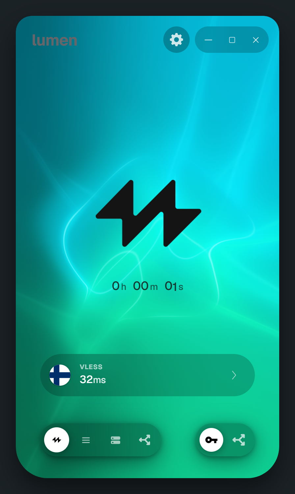
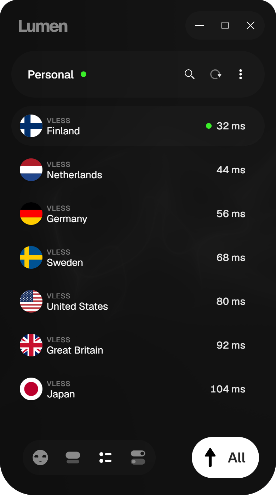
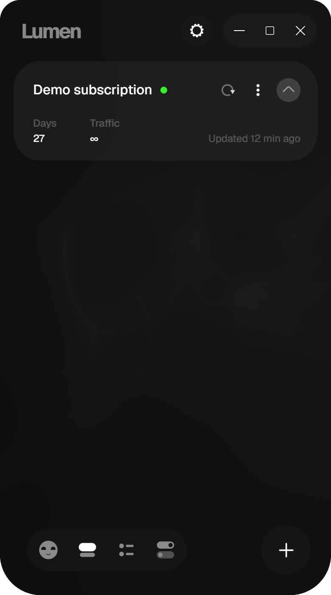
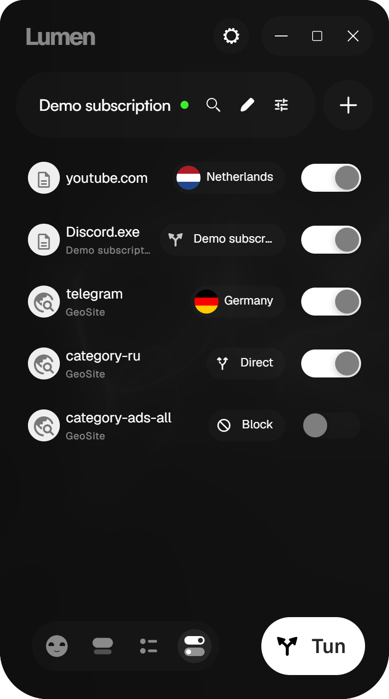

# Lumen

A compact desktop client for connecting to your own Xray-compatible VPN subscription on Windows. Add a link or key, pick a server, and connect from one small window.

**[Download for Windows x64](https://github.com/Sincopa/lumen-ray/releases/latest)** · [License](LICENSE)

## A look inside

<p align="center">
  <a href="docs/screenshots/home.png"></a>
  <a href="docs/screenshots/servers.png"></a>
  <a href="docs/screenshots/subscriptions.png"></a>
  <a href="docs/screenshots/rules.png"></a>
</p>

<p align="center"><sub>Click a screenshot to see it full size. These previews use sample data and the browser demo interface.</sub></p>

## What you can do

- **Keep your servers together.** Import subscription URLs, individual links, Base64 lists, Xray JSON, or Clash/Mihomo proxy lists. Refresh subscriptions without rebuilding your list by hand.
- **Choose with context.** Search servers, check their latency, and switch the active node from the same window.
- **Control the route.** Use the Windows system proxy or a TUN adapter. In TUN mode, choose global routing or rules for apps, domains, and IP ranges.
- **Make it yours.** Switch between English and Russian, adjust the interface and animated background, and manage core and app updates in Settings.

Lumen supports VLESS, VMess, Trojan, Shadowsocks, Hysteria 2, and Xray WireGuard outbounds. Some provider-specific extensions are unsupported; the app reports entries it cannot import.

## Get started

1. Download and install the latest Windows x64 release.
2. Open **Subscriptions** and add your provider's subscription URL or connection key.
3. Open **Servers**, choose a node, then click the Lumen symbol on **Home** to connect.
4. To change how traffic is routed, open **Settings → Network → Working Mode**.

| Mode             | What it does                                                                                                                                                    |
| ---------------- | --------------------------------------------------------------------------------------------------------------------------------------------------------------- |
| **System Proxy** | Sets the current user's Windows HTTP/HTTPS proxy. Only apps that use the system proxy are affected.                                                             |
| **TUN Adapter**  | Routes traffic through a virtual adapter. Windows asks for administrator approval when the TUN helper starts. Global and rule-based routing are available here. |

> **Current status:** Proxy connectivity has been tested locally. Full-device and per-app TUN traffic, IPv6, and recovery after failures still need end-to-end verification. There is no Kill Switch. The browser demo shown above does not protect traffic.

## For developers

Lumen uses Svelte 5 and TypeScript for the interface, Tauri 2 and Rust for native integration, and a managed Xray core for connections. The browser build uses demo services; native networking runs only in Tauri.

**Requirements:** Node.js 22.12+, Rust 1.92+, MSVC Build Tools, Windows SDK, and WebView2.

```powershell
npm ci
powershell -NoProfile -File scripts/prepare-core.ps1
npm run tauri:dev
```

`prepare-core.ps1` downloads the pinned Xray and Wintun binaries and verifies the archive hash. Run it before a native build in a fresh checkout. For interface work without native networking, use `npm run dev`.

```powershell
npm run check
npm run lint
npm run format:check
npm test
npm run build
npm run test:e2e
cargo test --locked --manifest-path src-tauri/Cargo.toml
cargo clippy --locked --manifest-path src-tauri/Cargo.toml --all-targets --all-features -- -D warnings
```

On Windows, `npm run test:tun` checks DNS, IPv4/IPv6 routes, and video playback through an already connected Lumen TUN session. It does not change the connection. `npm run benchmark:latency` measures the startup time and memory of one and four isolated Xray probe processes without a subscription.

The release workflow builds the Windows installer and signed updater artifacts from a version tag. Native data is stored as user-scoped DPAPI ciphertext under `%LOCALAPPDATA%\app.lumen.desktop\data`. The installer does not currently have an Authenticode signature.
