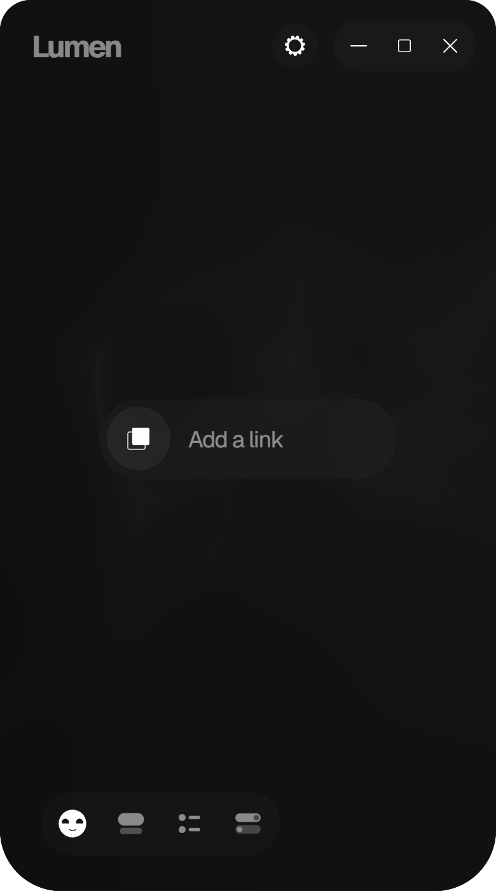
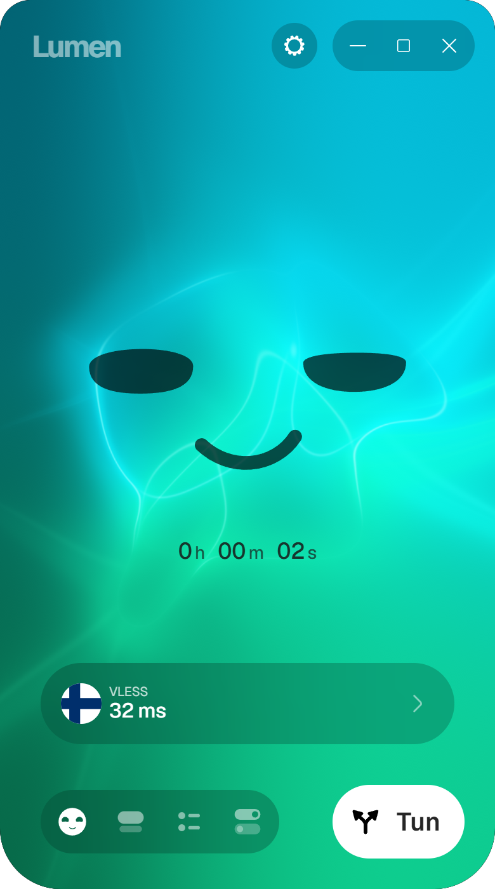
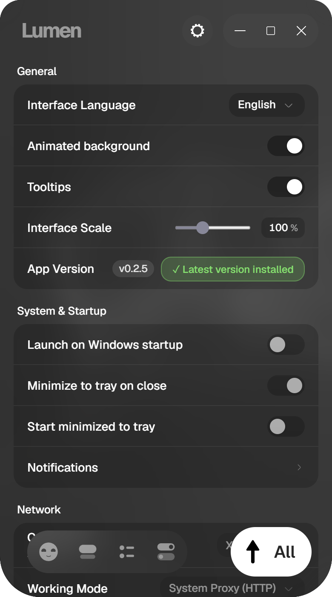
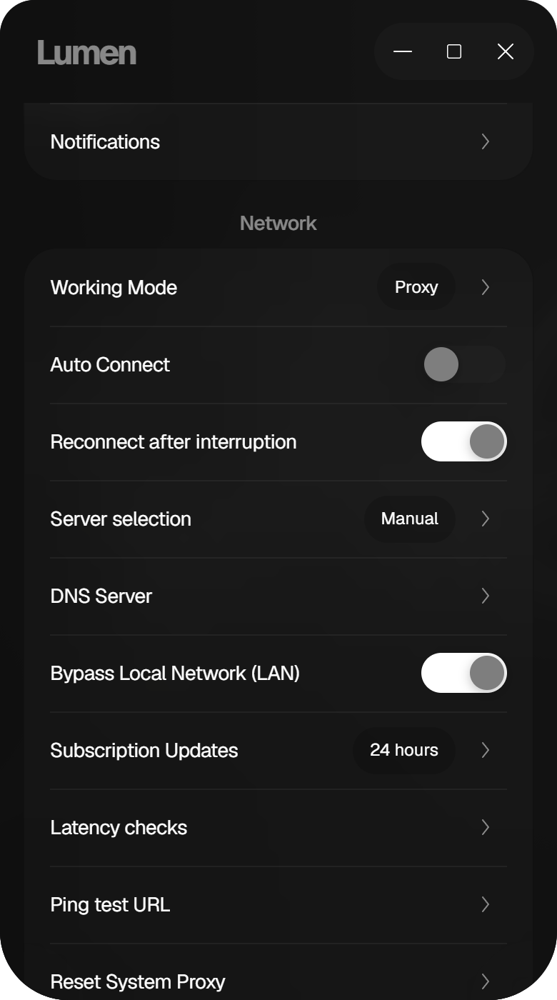

# Lumen

Windows, macOS and Android app for a VPN or proxy subscription you already have.

**[Download for Windows x64](https://github.com/Sincopa/lumen-ray/releases/latest)** · **[Download for macOS](https://github.com/Sincopa/lumen-ray/releases/latest)** · [Report a bug](https://github.com/Sincopa/lumen-ray/issues) · [Proprietary (All Rights Reserved)](LICENSE)

## Screenshots

<p align="center">
  <a href="docs/screenshots/empty.png"></a>
  <a href="docs/screenshots/home.png"></a>
  <a href="docs/screenshots/connected.png"></a>
  <a href="docs/screenshots/servers.png"></a>
</p>
<p align="center">
  <a href="docs/screenshots/subscriptions.png"></a>
  <a href="docs/screenshots/rules.png"></a>
  <a href="docs/screenshots/settings.png"></a>
  <a href="docs/screenshots/settings-network.png"></a>
</p>

No subscription yet, home, connected and servers; then subscriptions, rules and settings.

## Start

1. Download **Setup.exe** or **Portable.zip** from [Releases](https://github.com/Sincopa/lumen-ray/releases/latest).
2. Run Setup, or unpack the whole ZIP into a folder. `runtime` has to stay next to `Lumen.exe`. Do not launch the program from inside the archive.
3. Open **Subscriptions → Add profile** and paste the link or key from your provider.
4. Choose a server, then click the Lumen mark on **Home**.

Lumen does not include a subscription.

**System proxy** is enough for browsers and other programs that follow the Windows proxy setting. **TUN** covers more traffic. Windows asks for administrator approval when the adapter starts. Switch this in **Settings → Network → Working Mode**. There is no kill switch: disconnect in the app when you want traffic to go out normally again.

The first launch can show a SmartScreen warning. The app is signed with a certificate that other computers do not trust yet.

If a message says WebView2 is missing, install it from [Microsoft](https://developer.microsoft.com/microsoft-edge/webview2/).

### macOS

1. Download the **.dmg** from [Releases](https://github.com/Sincopa/lumen-ray/releases/latest). One build runs on Apple Silicon and Intel, macOS 13 or newer.
2. Open it and drag **Lumen** to **Applications**, then start it from there.
3. Add a profile and connect the same way as on Windows.

The macOS build uses an ad-hoc signature and is not notarized by Apple. If macOS blocks the first launch, open **System Settings → Privacy & Security → Open Anyway**, then confirm the launch.

Only **System proxy** works on macOS for now. It covers browsers and other programs that follow the macOS proxy settings. TUN is not available on macOS yet.

### Android

1. Download **Lumen-…-arm64.apk** from [Releases](https://github.com/Sincopa/lumen-ray/releases/latest) (`universal` works on any phone, `arm` is for old 32-bit ones). Android 8 or newer.
2. Open the file and allow installing apps from that source when Android asks.
3. Add a profile, choose a server and tap the Lumen mark. Android asks once whether Lumen may set up a VPN.

Lumen on Android is always a full VPN. An app rule set to **Direct** keeps that app outside the VPN; other app rules apply on desktop only. For a kill switch, open **Settings → Android → Always-on VPN** and turn on "Always-on VPN" and "Block connections without VPN" for Lumen. The Quick Settings tile connects and disconnects without opening the app.

## If something breaks

Open an [issue](https://github.com/Sincopa/lumen-ray/issues) with the app version, your Windows, macOS or Android version, and what you clicked. Do not paste a subscription link, a key, or a password.

## Build it yourself

Node.js 22.12 or newer, Rust 1.92 or newer, and Visual Studio Build Tools with the Windows SDK.

```powershell
npm ci
powershell -NoProfile -File src-tauri/build/prepare-core.ps1
npm run tauri:dev
```

`npm run build:release` writes the installer and the portable ZIP to `release/`.

On macOS: Node.js 22.12 or newer, Rust 1.92 or newer with both Apple targets, and the Xcode Command Line Tools.

```sh
npm ci
rustup target add aarch64-apple-darwin x86_64-apple-darwin
npm run tauri:dev:macos
```

`tauri:dev:macos` first builds the verified universal Xray core into `src-tauri/runtime/xray/xray`; plain `cargo` commands need it too (`npm run prepare:core:macos`). `npm run tauri:build:macos` writes `Lumen.app` and the disk image to `src-tauri/target/universal-apple-darwin/release/bundle/`. Set `APPLE_SIGNING_IDENTITY` to sign the core and the app with a Developer ID, and `APPLE_ID`, `APPLE_PASSWORD` and `APPLE_TEAM_ID` to notarize.

### Build for Android

Use bash (Git Bash on Windows), JDK 17, Android SDK platform 36 with build-tools 36.1.0, NDK r29, and the Go version in `android/core/go.mod`. Install the Rust targets and the pinned mobile tools:

```bash
npm ci
rustup target add aarch64-linux-android armv7-linux-androideabi x86_64-linux-android
cd android/core
go install golang.org/x/mobile/cmd/gomobile
go install golang.org/x/mobile/cmd/gobind
cd ../..
npm run android:core
npm run android:build:debug
```

`android/scripts/env.sh` looks for tools in `~/Android/{jdk17,sdk,go,gopath}`. Override this with `LUMEN_ANDROID_TOOLS` or `JAVA_HOME`, `ANDROID_HOME` and `NDK_HOME`. The core build also needs `ANDROID_NDK_HOME`.

The debug APK is `release/android/Lumen-debug-arm64.apk`. `npm run android:dev` starts development on a connected phone. `npm run android:build` produces release APKs for arm64, armv7 and x86_64, a universal APK, and `SHA256SUMS.txt` in `release/android/`.

Create a release signing key once:

```bash
bash android/scripts/new-keystore.sh
npm run android:build
```

Keep an offline backup of `android/keystore/lumen-release.jks` and `android/keystore.properties`; both are excluded from Git. Android updates need the same key. Without a key, release APKs have an `-unsigned` suffix and cannot be installed.

GitHub Actions uses `ANDROID_KEYSTORE_BASE64`, `ANDROID_KEYSTORE_PASSWORD`, `ANDROID_KEY_ALIAS` and `ANDROID_KEY_PASSWORD` repository secrets. For other build environments, set `LUMEN_ANDROID_KEYSTORE` (relative to `android/`), `LUMEN_ANDROID_KEYSTORE_PASSWORD`, `LUMEN_ANDROID_KEY_ALIAS` and `LUMEN_ANDROID_KEY_PASSWORD`.

The release workflow verifies locally signed Android APKs attached to the draft release, so the signing key can stay on the build machine. Upload all four APKs and `SHA256SUMS.txt` to the matching version's draft before the Windows build finishes. Publication waits for Android checksums, signatures and alignment checks as well as the desktop builds.

The shared interface and Rust backend stay in `src/` and `src-tauri/`. Android-specific code lives in `android/core/` (embedded Xray), `android/plugin/` (VPN service, Quick Settings tile, boot handling and Keystore), `android/gradle/` and `android/scripts/`. `android/scripts/init.sh` generates `src-tauri/gen/android`, copies launcher icons and applies the signing settings; the generated project is excluded from Git.

The VPN service runs independently of the interface. Its saved connection plan is encrypted with Android Keystore, backup is disabled, and the local SOCKS endpoint requires a fresh password. Xray is bundled with the APK and updates with the app.

Before publishing, check connection changes, Wi-Fi/mobile transitions, airplane mode, reboot with automatic connection enabled, the Quick Settings tile, Always-on VPN, app exclusions and DNS/IPv6 behavior on supported Android versions. Service logs are available with `adb logcat -s LumenVpn LumenRuntime LumenVpnPlan`; Rust logs use the `app_lib` tag.

Proprietary, All Rights Reserved. See [LICENSE](LICENSE). Xray, Wintun, and the fonts keep their own license files in the repository.
